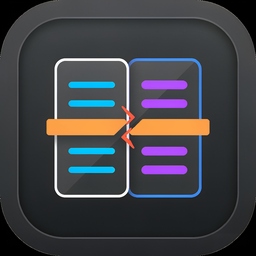

<div align="center">
  
  <h1>DiffScope</h1>
  <p>文件与文件夹对比 · 差异查看 · 合并同步</p>
  <p>
    
    
    
    
  </p>
</div>

DiffScope 是一个用 Python + PySide6 编写的桌面文件 / 文件夹对比工具，功能面对齐 Beyond Compare：左右分栏比较、行内差异高亮、目录树状态、合并与同步、专用查看器、报告与脚本，以及 Git / SQLite 等扩展能力。界面为中文（可切英文），支持深色 / 浅色主题，Windows 与 macOS 双平台。

> 差异配色：修改 = 橙，仅左侧 = 蓝，仅右侧 = 紫，含差异目录 = 暗橙，读取错误 = 红。

---

## 一、下载与安装

前往 [Releases](https://github.com/GluckMI/DiffScope/releases/latest) 下载对应平台的最新版本（当前 v2.2.0）：

| 平台 | 文件 | 用法 |
|---|---|---|
| Windows | `DiffScope-windows-x64.zip` | 解压后双击 `DiffScope.exe`，免安装 |
| macOS | `DiffScope-macos.dmg` | 打开后把 `DiffScope.app` 拖进「应用程序」 |
| macOS | `DiffScope-macos.zip` | 在 **macOS 上**解压，得到 `DiffScope.app` |

macOS 首次打开请 **右键 →「打开」** 绕过 Gatekeeper（应用未签名）。若在 Windows 上解压 mac 的 zip 再拷贝过去，可能丢失可执行权限与符号链接，导致 App 无法启动。

需要 Windows 安装器时，本机装有 Inno Setup 6 可执行：

```bat
packaging\build_windows.bat
iscc packaging\installer.iss
```

产物为 `dist\DiffScope-windows-setup.exe`，支持桌面快捷方式与「发送到」菜单。

---

## 二、从源码运行

```bash
# 1. 安装依赖（Python 3.10+）
python -m pip install -r requirements.txt

# 2. 启动图形界面
python run.py          # 自动探测带 PySide6 的解释器
run.bat                # Windows 双击启动

# 3. 环境诊断 / 帮助
python run.py --check
python run.py --help
```

依赖说明：`PySide6>=6.6` 是唯一必需依赖；`requests / Pillow / openpyxl / PyPDF2` 为可选增强，缺失时对应功能自动降级并给出提示，核心比较不受影响。

---

## 三、功能总览

### 比较核心

| 能力 | 说明 |
|---|---|
| 文件 / 文件夹比较 | 目录树按状态着色，按大小、时间戳或内容哈希判断，支持排除规则、大小写/空白忽略、Unicode 文件名规范化（macOS NFD ↔ Windows NFC） |
| 文本比较 | 逐行 + 行内字符级差异、语法着色（Python / C/C++ / Java / C# / JS / SQL / XML / HTML / INI / Go / Rust / JSON / YAML / Markdown 等）、手动对齐与断开、软换行 |
| 显示过滤 | 「全部 / 仅差异 / 仅相同」，差异段带上下文，过滤态只读 |
| 专用查看器 | 表格（CSV / XLSX 多工作表）、十六进制、图片（像素差异 + dHash 感知相似度）、音频标签、注册表导出文件、PDF / Word / DFM 转换后比较、剪贴板内容比较 |
| 大文件优化 | 后台线程加载、阶段进度、合并式整行选区、字节层扫描；万行以上文件仍可流畅滚动 |
| 数据源（VFS） | 本地、FTP/FTPS、SFTP、WebDAV、S3、Dropbox、OneDrive、SVN、SMB，以及文件系统快照（离线比较） |
| Git 集成 | 界面直接比较仓库中 HEAD ⇄ 工作区的改动；设置页可生成 `git difftool` / `mergetool` 配置命令 |
| SQLite 比较 | 两个数据库的同名表按主键对齐，列出新增 / 删除 / 修改及变更列 |
| 性能 | 内容签名缓存（`mtime + size`）+ 目录级并行预计算，重复比较不再重复读盘 |

### 合并与同步

- 左右合并当前差异块、**选择性合并**（勾选若干块统一方向应用）
- 三向文本合并、三向文件夹合并，冲突可优先取 base / left / right
- 4 种同步模式：自定义单向、镜像、更新、双向；执行前列出待执行动作并确认
- 同步预演报告导出 CSV；保存前自动备份，支持**从备份一键恢复**
- 所有写盘操作都需显式确认，删除优先走回收站

### 编辑器与工作流

- Ctrl + 滚轮缩放字号、编辑后防抖自动重比较（可关）、差异 / 书签列表侧栏、缩略图、行号、书签跳转
- 底部信息栏实时显示当前光标所在行两侧的对应内容与原始行号
- 查找 / 替换、行详情、导出差异清单（CSV / XML）、报告（HTML / CSV / TXT）
- 会话保存与恢复、**主页最近比较列表**（可右键删除单条 / 清空全部）、一键恢复上次会话
- 比较模板、比较规则、文件名对齐覆盖、标签页工作区、独立文本编辑器
- 脚本处理器（批处理自动化）、快捷键自定义、Windows 右键菜单集成、中英文界面、便携模式

---

## 四、常用快捷键

| 快捷键 | 功能 | 快捷键 | 功能 |
|---|---|---|---|
| `Ctrl+O` | 打开对比 | `Ctrl+R` | 重新比较 |
| `Ctrl+S` | 保存修改 | `Esc` | 返回目录对比 |
| `F7` / `F8` | 上 / 下一处差异 | `Ctrl+F` / `F3` | 查找 / 下一个匹配 |
| `Ctrl+H` | 查找替换 | `Ctrl+B` | 切换书签 |
| `Ctrl+Left` / `Ctrl+Right` | 合并当前差异（右→左 / 左→右） | `Ctrl+滚轮` | 缩放编辑器字号 |
| `Ctrl+Shift+S` | 保存会话 | `Ctrl+Shift+O` | 打开会话文件 |
| `Ctrl+T` | 标签页工作区 | | |

快捷键可在「扩展 → 设置」中自定义。开始页与对比界面均支持**拖拽文件 / 文件夹**直接打开比较。

---

## 五、命令行

不启动界面即可比较、合并、跑脚本，适合 CI 与自动化：

```bash
# 比较两个目录/文件，输出差异（可生成报告或 JSON）
python run.py --diff 左侧 右侧
python run.py --diff 左侧 右侧 --report report.html
python run.py --diff 左侧 右侧 --json --quiet

# 三向文本合并（冲突时可选优先方）
python run.py --merge 祖先 左 右 输出.txt --favor left

# 执行批处理脚本（写操作需显式放行）
python run.py --script 脚本.txt --allow-write

# 创建文件系统快照
python run.py --snapshot 目录 快照.json

# 预填路径启动图形界面
python run.py --compare 左侧 右侧
```

常用选项：`--ignore-case`、`--ignore-whitespace`、`--timestamp-only`、`--exclude 规则`（可重复）、`--quiet`。

**退出码**：`0` 无差异 / `1` 发现差异 / `2` 执行错误 / `3` 合并冲突。

脚本支持 `load`、`compare`、`filter`、`select`、`option / criteria`、`report / folder-report / text-report`、`sync`、`snapshot`、`log`、`pause` 等命令；直接调用 `python cli.py --help` 可查看完整参数。

---

## 六、数据目录

默认位于 `~/.diffscope/`，设 `DIFFSCOPE_PORTABLE=1`（或程序目录放置 `portable.flag`）后改用程序目录下 `Data/`：

| 路径 | 内容 |
|---|---|
| `settings.json` | 主题、字体、快捷键、最近比较记录等设置 |
| `sessions/` | 保存的会话（含 `_last.json` 上次会话） |
| `workspaces/` | 标签页工作区 |
| `backups/` / `trash/` | 保存备份与删除转存 |

---

## 七、项目结构

```
app/core/     纯 Python 逻辑层（不依赖 Qt，可独立测试）
  compare.py / text_diff.py / alignment.py / rules.py   比较引擎与规则
  vfs.py / vfs_remote.py / workspace.py                 统一数据源与工作区
  merge.py / merge3.py / sync.py / sync_modes.py        合并与同步
  media.py / binary.py / file_formats.py / formats.py   专用比较与格式转换
  git_diff.py / sqlite_diff.py / report.py / scripting.py
  session.py / services.py / i18n.py / models.py
app/ui/       PySide6 界面层
  main_window.py / file_view.py / folder_view.py
  widgets.py（编辑器、连线栏、缩略图、语法高亮）
  dialogs*.py / extended_views.py / viewers.py / theme.py
assets/       应用图标（ico / icns / png 母版与各尺寸）
packaging/    Windows 打包脚本与 Inno Setup 安装器配置
.github/      双平台构建与 Release 工作流
tests/        单元测试（GUI 用例使用 offscreen 平台）
run.py        启动入口（解释器探测 + 环境诊断）
cli.py        命令行入口
```

架构约定：核心逻辑放在 `app/core/`，`app/ui/` 只负责展示；新增数据源统一实现 `VfsProvider`，不要修改 `compare()` 的调用签名。

---

## 八、开发与测试

```bash
# 全量回归
python -m unittest discover -s tests -v

# 单组用例
python -m unittest tests.test_details.TestDisplayFilter -v
```

当前 **159 个测试全部通过**。测试覆盖比较引擎、文本差异、规则、VFS、同步、会话、脚本、报告、拖放、显示过滤、过滤态高亮、语法着色、启动恢复与最近记录删除等。GUI 用例自动使用 `QT_QPA_PLATFORM=offscreen`；注意测试中的模态弹窗需 mock，否则离屏环境会阻塞。

---

## 九、打包与发布

推送 `v*` 标签会自动触发 GitHub Actions 双平台构建并发布 Release：

```bash
git tag v2.2.0
git push origin v2.2.0
```

- 云端：macOS 产出 `.dmg` + `.zip`，Windows 产出 `.zip`，自动挂到 Release
- 本机 Windows：`packaging\build_windows.bat`（PyInstaller onedir）
- 本地打包若指定 `--distpath / --workpath / --specpath`，`--icon` 与 `--add-data` 必须使用**绝对路径**（相对路径按 spec 目录解析）

---

## 十、已知限制

- macOS 应用**未签名、未公证**，首次打开需右键「打开」；Windows 免安装包同样无签名，SmartScreen 可能提示
- 远程数据源（S3 / Dropbox / OneDrive / SFTP / SMB 等）需要用户自行提供凭证或可用服务，本项目未做实机连通验证，失败时会给出明确错误提示
- 自动更新检查需要自建 `version.json` 更新源，默认关闭
- Windows 右键菜单通过「发送到」快捷方式或注册表项实现，非原生 Shell Extension
- 大文本比较默认上限 64 MB / 10 万节点，可在设置中调整

---

## 十一、版本记录

| 版本 | 主要内容 |
|---|---|
| v2.2.0 | 编辑器增强（缩放 / 自动重比较 / 差异侧栏 / 新语法）、工作流（最近记录 / 模板 / 导出清单）、选择性合并与预演报告 / 备份恢复、Git / SQLite / 缓存并行 / 图片感知相似度、macOS dmg |
| v2.1.0 | 底部行内容栏、应用图标与全新配色、显示过滤高亮与语法着色修复 |
| v2.0.0 | 对齐 Beyond Compare 全部功能面：VFS、6 类专用比较器、三向合并、4 种同步模式、报告、CLI / 脚本、工作区、设置与集成 |
| v1.0 | 首版：左右分栏文件 / 文件夹对比、差异高亮、合并同步、会话 |

---

## 技术栈

Python 3.10+ · PySide6 6.6+（Qt for Python）· PyInstaller · Pillow（可选）· GitHub Actions

核心比较引擎不依赖 Qt，可作为纯 Python 库在脚本或 CI 中调用。
